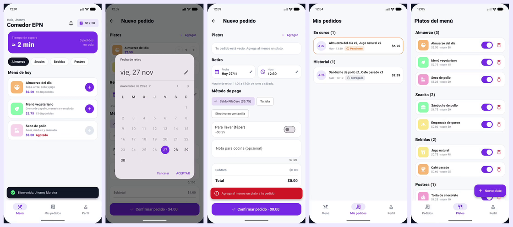

# FilaCero — CRUD en memoria

**Autor:** Jhonny Bryan Moreira Ramos · Aplicaciones Móviles · GR2 · Escuela Politécnica Nacional (2026-B)



## Descripción

Este proyecto contiene el **CRUD funcional de FilaCero**, la app para pedir comida en el comedor de la EPN sin hacer fila. Todos los datos se guardan **en memoria** (listas de Dart dentro de `AppStore`, un `ChangeNotifier`), sin base de datos. Se reinician al cerrar la app.

**Estudiante**
- **Crear** un pedido desde el menú con:
  - platos y cantidades
  - fecha y hora de retiro (`DatePicker` y `TimePicker` nativos)
  - método de pago
  - opción "para llevar"
  - nota para cocina
- **Ver** la lista de sus pedidos con su estado y el detalle de cada uno, con código QR.
- **Editar** un pedido mientras está *Pendiente*.
- **Eliminar** un pedido pendiente o rechazado, previa confirmación con un `AlertDialog` y aviso con un *toast* (`SnackBar`). Al eliminarlo se devuelven el stock y el saldo.

**Comedor**
- **Gestionar los pedidos:** los pasa por *Pendiente → En preparación → Listo → Entregado* o los rechaza con un motivo. El estudiante recibe una notificación en cada cambio.
- **CRUD de platos:** crear, editar, eliminar y activar o desactivar la disponibilidad, con precio, stock, categoría, ícono y color. Los chips de *Platos frecuentes* (Humita, Bolón, Encebollado, Morocho) llenan el formulario con un toque.

**Cuentas:** inicio de sesión y registro en memoria. Hay dos cuentas de prueba:

| Rol | Correo | Contraseña |
|---|---|---|
| Estudiante | `jhonny.moreira@epn.edu.ec` | `filacero123` |
| Comedor | `comedor@epn.edu.ec` | `comedor123` |

## Objetivo

Desarrollar en Flutter un CRUD completo de pedidos del comedor que funcione en memoria, aplique reglas de validación del negocio y use los componentes nativos de Material (diálogos, selectores de fecha y hora, *toasts*, switches, chips y barra de navegación).

## Reglas de validación

| Regla | Mensaje |
|---|---|
| El pedido debe tener al menos un plato | *Agrega al menos un plato a tu pedido* |
| No se puede pedir un plato agotado o desactivado | *"Seco de pollo" está agotado* |
| Máximo 5 unidades por plato y nunca más que el stock | *Solo quedan 3 de "Torta de chocolate"* |
| Retiro entre 11:00 y 15:00, de lunes a sábado | *El retiro debe ser entre 11:00 y 15:00* |
| La fecha no puede ser pasada ni estar a más de 6 días | *La fecha de retiro no puede ser pasada* |
| La hora debe estar al menos 10 minutos después de ahora | *Elige una hora al menos 10 minutos después de ahora* |
| Máximo 2 pedidos en curso por estudiante | *Ya tienes 2 pedidos en curso* |
| Si paga con saldo, el total no puede superar el saldo | *Saldo insuficiente: tienes $X y el pedido cuesta $Y* |
| Solo se edita un pedido *Pendiente* y solo se elimina uno *Pendiente* o *Rechazado* | *Solo puedes editar pedidos pendientes* |
| Plato: nombre de 3 letras o más y sin repetir, precio entre $0.25 y $20, stock entre 0 y 200 | *Ya existe un plato llamado "…"* |
| No se elimina un plato que está en pedidos activos | *No se puede eliminar: hay pedidos activos con "…"* |
| Registro: correo `@epn.edu.ec`, contraseña de 8 caracteres o más que coincida, correo no repetido | *Usa tu correo institucional @epn.edu.ec* |

Al crear, editar, eliminar o rechazar un pedido se recalculan automáticamente el **stock** de los platos y el **saldo** del estudiante.

## Operaciones CRUD

| | Pedidos (estudiante) | Platos (comedor) |
|---|---|---|
| **Create** | `crearPedido()` desde *Nuevo pedido* | `guardarPlato()` desde *Nuevo plato* |
| **Read** | *Mis pedidos* y *Detalle del pedido* | *Platos del menú* y *Menú de hoy* |
| **Update** | `actualizarPedido()` (solo si está pendiente) | `guardarPlato(existente)` y el switch de disponibilidad |
| **Delete** | `eliminarPedido()` con `AlertDialog` | `eliminarPlato()` con `AlertDialog` |

Además, el comedor cambia el estado de los pedidos con `avanzarEstado()` y `rechazarPedido()`.

## Componentes nativos usados

`AlertDialog` (confirmar eliminación, rechazar con motivo, cerrar sesión) · `SnackBar` (toasts de éxito y error) · `showDatePicker` · `showTimePicker` · `showModalBottomSheet` · `SwitchListTile` y `Switch` · `ChoiceChip` · `NavigationBar` con `Badge` · `FloatingActionButton.extended` · `QrImageView`. La interfaz está en español gracias a `flutter_localizations`.

## Estructura

```
lib/
├── main.dart                  App, tema y localización es-EC
├── data/
│   ├── models.dart            Usuario, Plato, Pedido, ItemPedido, EstadoPedido, Notificacion
│   └── app_store.dart         "Base de datos" en memoria + reglas de negocio (CRUD)
├── widgets/ui.dart            toast(), confirmar() (AlertDialog), tarjetas, chips de estado
└── screens/
    ├── auth/                  login, registro
    ├── student/               menú, nuevo/editar pedido, mis pedidos, detalle, notificaciones, perfil
    └── staff/                 pedidos del comedor, platos, nuevo/editar plato
test/crud_test.dart            14 pruebas de las reglas del CRUD y de navegación
```

## Cómo ejecutarlo

1. Abrir la carpeta `FilaCero-CRUD` en Android Studio con el plugin de Flutter (Flutter 3.35 o superior).
2. Ejecutar `flutter pub get`.
3. Elegir el emulador **Pixel 8 Pro** y presionar ▶ **Run**.
4. Pruebas: `flutter test`.

## Video

[../docs/FilaCero_CRUD.mp4](../docs/FilaCero_CRUD.mp4): grabado en el emulador Pixel 8 Pro desde Android Studio.
