# FilaCero — Pide en el comedor sin hacer fila

**Autor:** Jhonny Bryan Moreira Ramos · Aplicaciones Móviles · GR2 · Escuela Politécnica Nacional (2026-B)

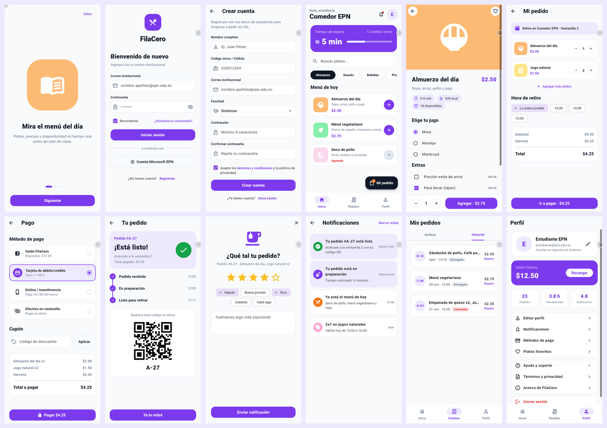

## Descripción

FilaCero es una aplicación móvil para pedir comida en el comedor de la Escuela Politécnica Nacional sin hacer fila. Hoy, en la hora pico (13:00–14:00), el estudiante pasa buena parte de su receso esperando en la fila, no sabe qué hay en el menú y solo al llegar a la caja se entera de si su plato se acabó.

Con FilaCero el estudiante ve el menú del día con precios y disponibilidad, el tiempo de espera estimado y cuántos pedidos hay antes que el suyo. Arma su pedido como en una app de delivery, paga en la app y recibe un código QR. Cuando el pedido está listo, se acerca a la ventanilla y lo retira mostrando el código.

Este repositorio contiene las **17 interfaces** de la app hechas en **Flutter** (Dart, Material 3): carga, onboarding, login, registro, verificación, recuperación de contraseña y todas las pantallas del flujo de pedido, con menú inferior, botón atrás y navegación completa entre pantallas. Las pantallas no están conectadas a un backend: usan datos de ejemplo.

## Objetivo

Implementar todas las interfaces de FilaCero a partir de los bocetos de baja fidelidad y del prototipo de alta fidelidad, usando en cada pantalla los widgets de Flutter adecuados (tarjetas, listas, chips de filtro, formularios, radios, checkboxes, pestañas, barra de navegación, código QR y mensajes Snackbar) y una navegación clara de principio a fin.

## Video

[docs/FilaCero_Interfaces.mp4](docs/FilaCero_Interfaces.mp4): recorrido completo de la app (onboarding → registro → menú → plato → carrito → pago → QR → calificación → pedidos → perfil).

## Tecnologías

| | |
|---|---|
| Framework | Flutter 3.47 (Dart 3.13), Material 3 |
| IDE | Android Studio con el plugin de Flutter |
| Plataformas | Android, iOS y Web |
| Paquetes | `qr_flutter` (código QR para retirar el pedido) |

## Pantallas

| # | Pantalla | Archivo | Widgets principales |
|---|---|---|---|
| 1 | Splash | `splash_screen.dart` | `CircularProgressIndicator`, `Timer` |
| 2 | Onboarding (3 pasos) | `onboarding_screen.dart` | `PageView.builder`, `AnimatedContainer` (indicador) |
| 3 | Iniciar sesión | `auth/login_screen.dart` | `TextField`, `Checkbox`, `FilledButton`, `OutlinedButton` |
| 4 | Crear cuenta | `auth/register_screen.dart` | `TextField`, `DropdownButtonFormField`, `Checkbox` |
| 5 | Verificar correo | `auth/verify_code_screen.dart` | Casillas del código de 4 dígitos |
| 6 | Recuperar contraseña | `auth/forgot_password_screen.dart` | `TextField`, `SnackBar` |
| 7 | **Menú del día** (pantalla 1 del prototipo) | `menu/home_screen.dart` | `AppBar` + `CircleAvatar`, `Card` + `LinearProgressIndicator`, `ChoiceChip`, `IconButton.filled`, `FloatingActionButton.extended` + `Badge` |
| 8 | Detalle del plato | `menu/dish_detail_screen.dart` | `SliverAppBar`, `RadioGroup`, `CheckboxListTile`, `Chip` |
| 9 | Mi pedido (carrito) | `order/cart_screen.dart` | Selector de cantidad, `ChoiceChip` (hora de retiro) |
| 10 | Pago | `order/payment_screen.dart` | Tarjetas seleccionables de método de pago, cupón |
| 11 | Pedido confirmado | `order/order_success_screen.dart` | Número de pedido |
| 12 | **Tu pedido + QR** (pantalla 2 del prototipo) | `order/order_tracking_screen.dart` | `Card` de estado, línea de tiempo, `QrImageView` |
| 13 | Calificar pedido | `order/rate_order_screen.dart` | Estrellas, `FilterChip`, `TextField` |
| 14 | Mis pedidos | `order/orders_history_screen.dart` | `TabBar` (Activos / Historial), `ListTile` |
| 15 | Perfil | `profile/profile_screen.dart` | Saldo, estadísticas, menú de opciones |
| 16 | Editar perfil | `profile/edit_profile_screen.dart` | `TextField`, `FilterChip` (preferencias) |
| 17 | Notificaciones | `notifications_screen.dart` | `ListView.separated`, `ListTile` |

Menú inferior (`NavigationBar`): **Inicio · Pedidos · Perfil**.

## Flujo de navegación

```
Splash → Onboarding → Login ─┬─ Regístrate → Crear cuenta → Verificar ─┐
                             ├─ ¿Olvidaste tu contraseña? → Recuperar   │
                             └─ Iniciar sesión ─────────────────────────┴→ Inicio

Inicio ─ Menú del día → Detalle del plato → Mi pedido → Pago → Pedido confirmado
                                                 → Tu pedido (QR) → Calificar → Inicio
       ─ 🔔 Notificaciones
Pedidos ─ Activos / Historial → Tu pedido
Perfil ─ Editar perfil · Notificaciones · Cerrar sesión → Login
```

## Estructura

```
FilaCero-Interfaces/
├── lib/
│   ├── main.dart              App y tema
│   ├── routes.dart            Rutas con nombre de las 17 pantallas
│   ├── theme/app_theme.dart   Colores y estilos del prototipo
│   ├── data/mock_data.dart    Platos y pedidos de ejemplo
│   ├── widgets/common.dart    DishCard, LabeledField, QuantitySelector, SummaryRow...
│   └── screens/
│       ├── splash_screen.dart, onboarding_screen.dart, main_shell.dart, notifications_screen.dart
│       ├── auth/      login, registro, verificar código, recuperar contraseña
│       ├── menu/      menú del día, detalle del plato
│       ├── order/     carrito, pago, confirmado, seguimiento (QR), calificar, mis pedidos
│       └── profile/   perfil, editar perfil
├── test/              Prueba que abre cada pantalla en tamaño de celular
├── android/ ios/ web/
└── pubspec.yaml
docs/
├── FilaCero_Interfaces.mp4
├── collage.png
└── capturas/
```

## Cómo ejecutarlo

1. Tener instalado Flutter (3.35 o superior) y Android Studio con el plugin de Flutter.
2. Abrir la carpeta `FilaCero-Interfaces` en Android Studio.
3. Ejecutar `flutter pub get`.
4. Elegir un emulador (por ejemplo, Pixel 8 Pro) o un celular conectado y presionar ▶ **Run** (o `flutter run`).

Para comprobar que todas las pantallas se construyen sin errores:

```
flutter test
```

## Capturas

| Onboarding | Login | Registro | Menú del día |
|---|---|---|---|
| 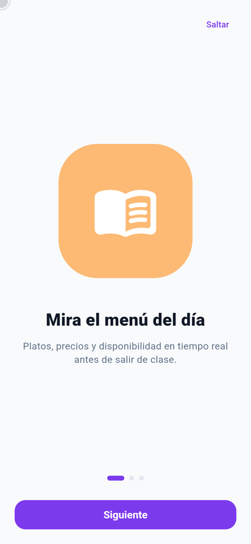 | 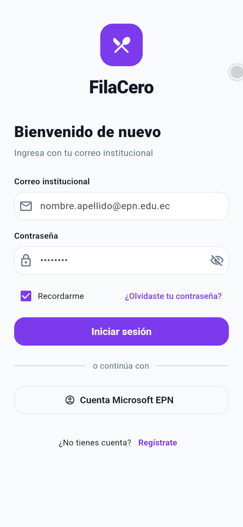 | 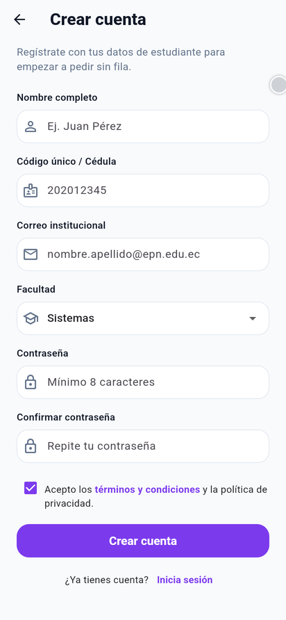 | 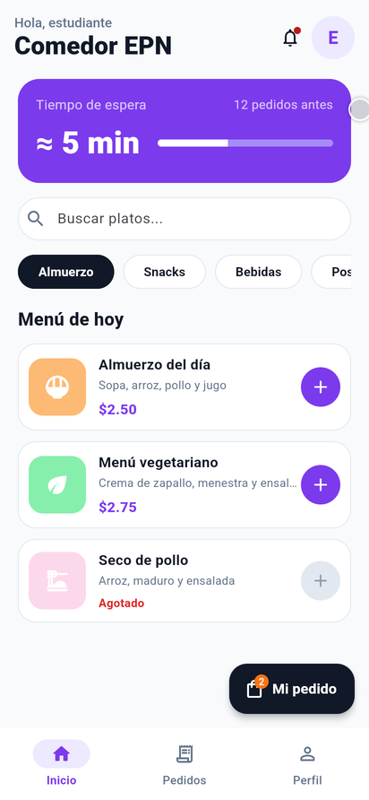 |

| Detalle del plato | Mi pedido | Pago | Tu pedido (QR) |
|---|---|---|---|
| 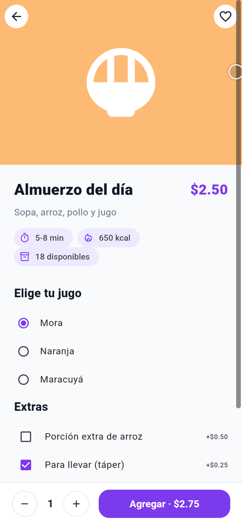 | 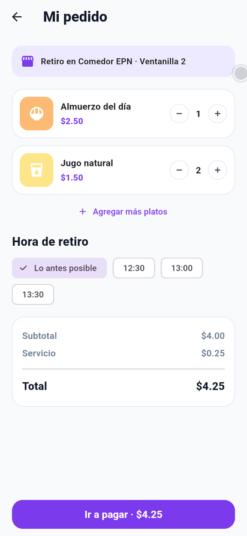 | 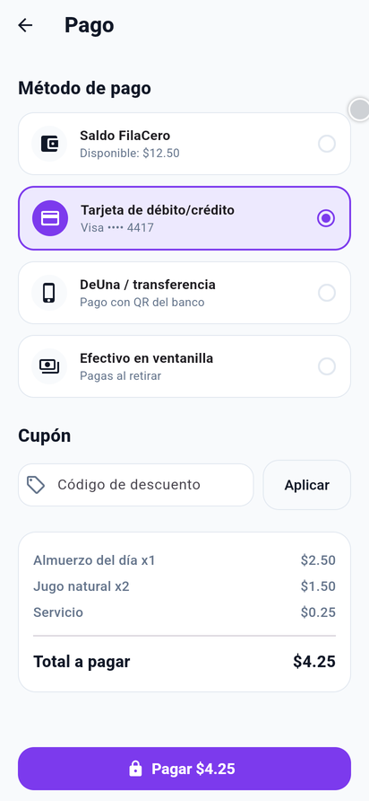 | 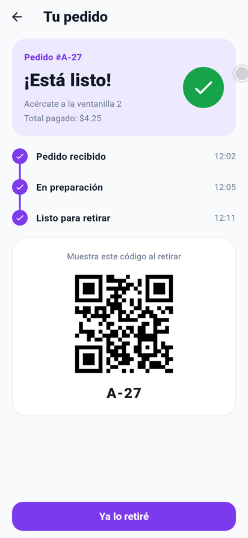 |

| Calificar | Notificaciones | Mis pedidos | Perfil |
|---|---|---|---|
| 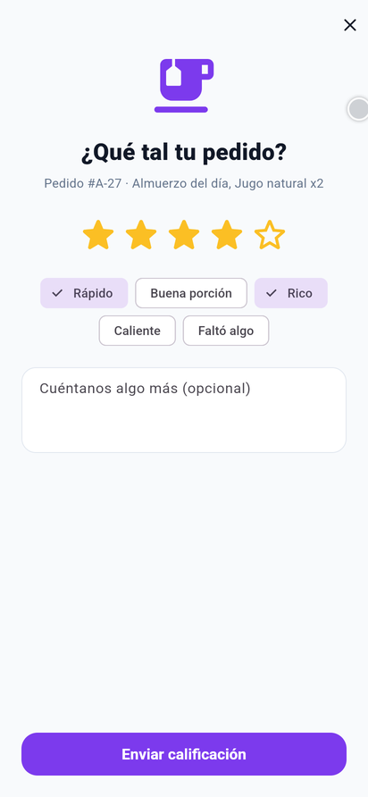 | 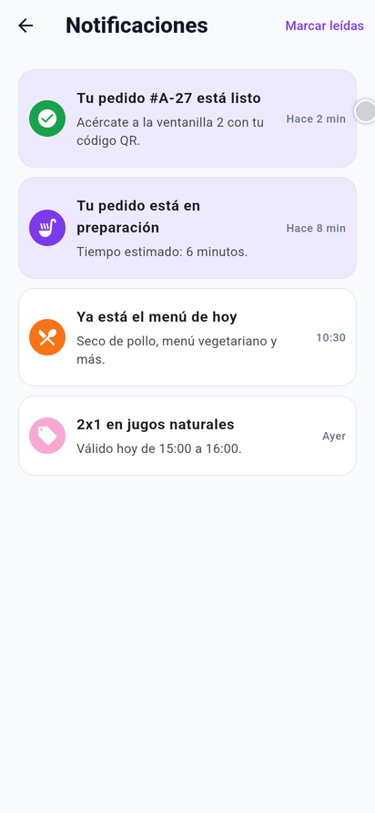 | 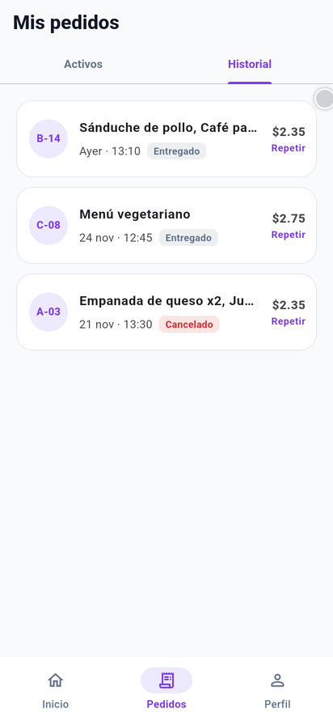 | 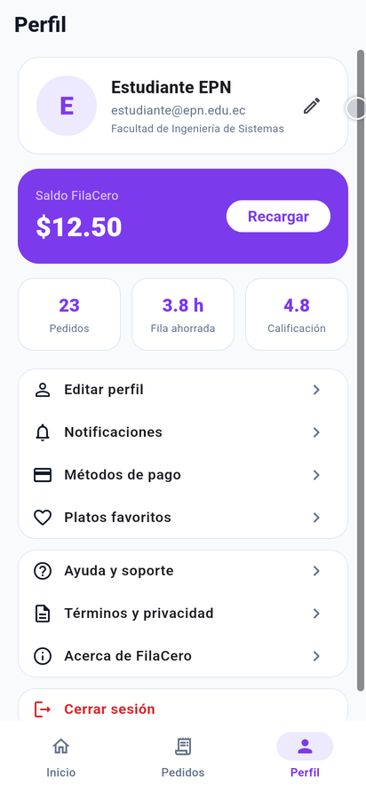 |
